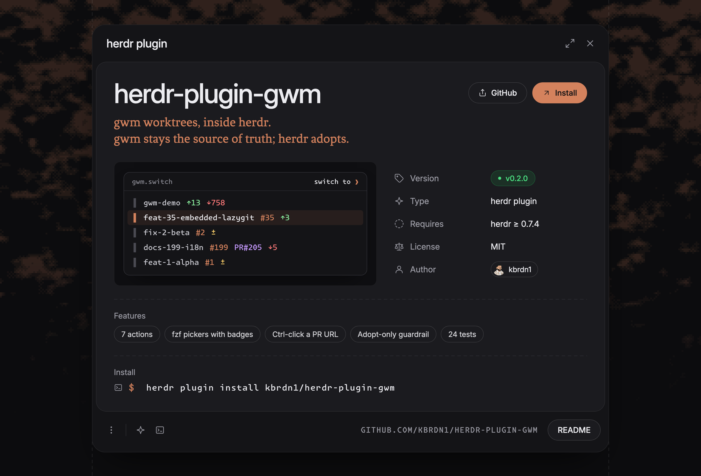

<p align="center">
  <picture>
    <source media="(prefers-color-scheme: dark)" srcset="docs/_assets/promo.png">
    <source media="(prefers-color-scheme: light)" srcset="docs/_assets/promo-light.png">
    
  </picture>
</p>

# herdr-plugin-gwm — gwm worktrees in herdr

[](LICENSE)
[](https://herdr.dev)
[](https://github.com/kbrdn1/gwm-cli)
[](bin/)

A [herdr](https://herdr.dev) plugin that drives **[gwm](https://github.com/kbrdn1/gwm-cli)** for git worktree management from inside the multiplexer: create, switch, remove, review a PR, exec across worktrees, clean build artifacts, and a live dashboard. herdr reflects each worktree as a workspace.

**gwm stays the single source of truth.** The plugin never creates a worktree on the herdr side — it only *adopts* what gwm produced (`worktree open --path`) and closes the reflections when gwm removes it (`workspace close`, `tab close`). One source of truth, no divergence. See [the one rule](#the-one-rule).

```
╭──────────────────────────── switch to ❯ ─────────────────────────────╮
│ ▌ gwm-demo  ↑13 ↓758                                                 │
│ ▌ feat-35-embedded-lazygit  #35  ↑3                                  │
│ ▌ fix-2-beta  #2  ±                                                  │
│ ▌ docs-199-i18n  #199  PR#205  ↓5                                    │
│ ▌ feat-1-alpha  #1  ±                                                │
╰──────────────────────────────────────────────────────────────────────╯
```

## install

| Channel | Command |
|:--------|:--------|
| Marketplace | `herdr plugin install kbrdn1/herdr-plugin-gwm` |
| Dev (local checkout) | `herdr plugin link "$PWD"` |

There is no `[[build]]` step — it's plain bash, so `plugin link` and `plugin install` both wire it up with nothing to compile.

**Requirements:** herdr ≥ 0.7.4 (popup panes) · `gwm` on `PATH` ([gwm-cli](https://github.com/kbrdn1/gwm-cli) ≥ 1.0; ≥ 1.3 for agent badges, ≥ 1.10 to derive a worktree from an existing issue) · `jq` · `fzf` · `bash` · macOS / Linux.

## the 30-second tour

From any pane inside a herdr workspace that sits in a gwm-managed repo:

```bash
herdr plugin action invoke gwm.switch      # fzf over gwm worktrees → focus if open, else adopt
herdr plugin action invoke gwm.create      # branch type → issue → desc (empty = issue title) → gwm create → adopt
herdr plugin action invoke gwm.remove      # fzf → dry-run preview → confirm (y / D) → gwm remove → close the reflections
herdr plugin action invoke gwm.review      # fzf over `gh pr list` → gwm review → adopt
herdr plugin action invoke gwm.exec        # a saved profile or a command, across every non-main worktree
herdr plugin action invoke gwm.clean       # pick a dir set → report reclaimable artifacts → confirm → delete
herdr plugin action invoke gwm.dashboard   # gwm's live TUI in a pane
```

Bind them to a key in `~/.config/herdr/config.toml` (then `herdr server reload-config`):

```toml
[[keys.command]]
key = "prefix+ctrl+shift+g"
type = "plugin_action"
command = "gwm.switch"
description = "gwm: switch worktree"
```

## what it does

- **`gwm.create`** — fzf over `gwm types` (branch type) → issue number → description → runs `gwm create`. Leave the description **empty** and gwm derives it from the issue's title instead (`gwm create --issue <N> --type <type>`, gwm ≥ 1.10, needs the repo's forge reachable): nothing to retype, and an issue that already has a worktree is just adopted again. Pick **`(auto)`** (last in the type list; parenthesised, so it can't shadow a configured type) and the type comes from the issue's labels too (`gwm create --issue <N>`, via `[issue_template.by_type.*].labels`); no description is asked, and gwm refuses, pointing at `--type`, when the labels don't select exactly one type. Cancel with Esc in the type picker. The plugin then resolves the new worktree by its **linked issue** (immune to description normalization) and adopts it into herdr. A typed description adds a fuzzy path lookup as fallback; an issue-derived one has none, so it needs a `branch_pattern` that carries `{issue}` (gwm's default does).
- **`gwm.switch`** — fzf over `gwm list --format=json` with live **badges** (issue `#N`, `PR#N`, dirty `±`, ahead `↑`, behind `↓`, and the most recent agent session `@claude` / `@codex` / …, starred `*` while active in the last 5 min; gwm ≥ 1.3, read from the optional `agents` field). If herdr already reflects the pick it just **focuses** the workspace (in `open_mode = "tab"`, a tab already showing only that worktree); otherwise it **adopts** it — no duplicates.
- **`gwm.remove`** — fzf over removable worktrees (never the main checkout) → gwm's own **`--dry-run` preview** (name, path, branch; an ambiguous pattern stops here), plus what herdr will close and which agents run there → a red warning when the worktree is dirty (its uncommitted and untracked files go with it; `gwm undo` doesn't bring them back) → an explicit **confirm gate** (gwm's `remove` doesn't prompt): `y` removes and keeps the branch, `D` deletes the branch too (even unmerged: gwm journals its tip, so `gwm undo` can bring it back), anything else cancels → `gwm remove` → closes herdr's reflections: the worktree's workspace, and every tab whose panes **all** sat inside the removed worktree. A tab with a pane elsewhere (its shell or its foreground program), or without a cwd, is left alone, and so is every tab of a workspace whose tabs all qualify (herdr closes a workspace with its last tab, and that workspace isn't the worktree's). The set is re-checked right after your answer and only what is still safe is closed; whatever stays open is reported. The tab or workspace the popup was opened from goes last, since herdr ends the popup with it.
- **`gwm.review`** — fzf over `gh pr list` (or a plain PR-number prompt) → `gwm review <N>` materializes the PR as an isolated worktree → adopt. Also wired to a **link handler**: Ctrl-clicking a GitHub PR URL (`…/pull/N`) triggers it, passing the strictly-extracted PR *number* to gwm — never a raw or forged URL. herdr routes link clicks to plugins only while `ui.mouse_capture` is on (Ctrl on every platform, macOS included); with capture off, your terminal's own link shortcut opens the browser instead.
- **`gwm.exec` / `gwm.clean`** — `gwm exec` fans a command across every non-main worktree with a `✓/✗` rollup: when the repo saves `[exec.profiles.<name>]` in `.gwm.toml`, a picker offers them **by name** next to "type a command" (picking one runs `gwm exec --profile=<name>`, i.e. that profile exactly as gwm's resolved config defines it: `.gwm.toml` over your global config; the picker doesn't show commands it would have to parse out of gwm's text), and an optional `jobs` prompt adds `--jobs N` (digits only; empty leaves it to gwm: a profile's `jobs`, else `[exec] jobs` from the resolved config, else sequential with live output). A run with failures ends in red, not "done" (clean's deletion too). `gwm clean` reports, across the same non-main worktrees, reclaimable build artifacts (`target/`, `node_modules/`, …) and deletes only git-ignored ones after a confirm; with `[clean.profiles.<name>]` saved, a picker chooses the directory set first (`(default set)` or a profile name), and the report and the deletion use the same one. Profiles are code shipped with the repo: in a repo you haven't vetted, read its `.gwm.toml` before picking one.
- **`gwm.dashboard`** — surfaces gwm's own TUI in a zoomed pane: the live worktree table with PR/CI/dirty/ahead-behind badges, no reimplementation.
- **`worktree.created` event** — a worktree created on the herdr side (outside gwm) is enriched by `gwm bootstrap` (`.env` copy, hooks, preset), run from inside that worktree so gwm uses its repo's `.gwm.toml` (herdr starts hooks in the plugin dir). The path comes from the event envelope (`.data.worktree.path`). Adopts fire `worktree.opened`, not `.created`, so this never double-runs on the plugin's own work.
- **Adopt-only guardrail** — every mutation goes through `gwm`; herdr is a reflection. A source-level test asserts no script ever emits `worktree create` or `worktree open --branch` (see [tests](#testing)).
- **Root-workspace adoption** — adopts under the repo's *root* workspace, so invoking from inside a linked-worktree pane doesn't hit herdr's `linked_worktree_source` rejection.
- **Popup pickers** — `gwm.switch` and `gwm.remove` open as a session-modal floating popup (herdr ≥ 0.7.4): the tiled layout doesn't move, Escape reaches fzf, and the popup closes when the script exits. The panes whose *output* is the point (`exec`, `clean`) or that run long git/network work (`create`, `review`) stay split — a modal that blocks the session for a 30s clone reads as frozen. `dashboard` stays zoomed. Placement and size (`width`/`height`) are declared once, on the `[[panes]]` entrypoint; the popup actions pass no `--placement`, which would override it.
- **Picker theming** — pickers inherit your `FZF_DEFAULT_OPTS` (colors, borders) by default, but neutralize file-browser-oriented bits (a `bat` preview, `ctrl-r` bound to `git ls-files`, `transform-header` on focus) that would garble non-file lines or rebind keys. Set `fzf_theme = "clean"` for a fully isolated picker.

## plugin or `gwm herdr`?

gwm ≥ 1.10 ships its own [`gwm herdr <pattern>`](https://github.com/kbrdn1/gwm-cli). Both open a gwm worktree inside herdr and neither creates anything on the herdr side; they differ in what herdr ends up holding, so keep both.

| | plugin, `open_mode = "workspace"` (default) | plugin, `open_mode = "tab"` | `gwm herdr <pattern>` |
|:--|:--|:--|:--|
| herdr call | `worktree open --path` under the repo's root workspace | `tab create --workspace <current> --cwd` | `tab create --workspace <current> --cwd`, or `pane split --current` with `-p` / `--direction` |
| you get | a **workspace** of its own, grouped under the repo in the sidebar, with git checkout provenance | a tab in the current workspace | a tab, or a split pane, in the current workspace |
| picking | fzf with badges; focuses it if already open | fzf with badges; focuses a tab already only on it, else a new tab | a fuzzy name you type, or the `t` key in gwm's TUI |
| after `gwm.remove` | its workspace is closed | its tab is closed | its tab is closed; a split pane in a mixed tab stays |
| needs | the plugin | the plugin | only gwm, run from a herdr pane (`$HERDR_ENV`) |

Use the **plugin** when the worktree is a unit of work you switch to and back from (an agent per worktree, its own tabs and panes): it lands in the repo's worktree group, `gwm.switch` never opens a duplicate, and `gwm.remove` takes the reflection down with it. Use **`gwm herdr`** to look at a worktree next to what you're doing, from a shell, a script or gwm's TUI: no plugin, no picker, nothing left in the sidebar.

One trap: gwm's TUI setting `[tui] mux_open_in = "workspace"` runs `herdr workspace create`, a plain top-level workspace that herdr does **not** group as a worktree of the repo. The grouped workspace is the plugin's default.

## configuration

Presentation mode lives in the herdr-managed config dir — create `~/.config/herdr/plugins/config/gwm/config.toml` (or run `herdr plugin config-dir gwm` to find it):

```toml
# "workspace" (default) → adopt as a nested worktree workspace in the sidebar.
# "tab"                 → lighter: open a tab with the worktree cwd.
open_mode = "workspace"

# "user" (default) → inherit your FZF_DEFAULT_OPTS (colors/theme); the picker
#                    only neutralizes file-browser bits (bat preview, ctrl-r →
#                    git ls-files, transform-header on focus).
# "clean"          → drop FZF_DEFAULT_OPTS entirely for a bare, predictable picker.
fzf_theme = "user"
```

## the one rule

> The plugin never calls `herdr worktree create` or `worktree open --branch`.
> Creation / removal always goes through `gwm`; herdr only reflects via
> `worktree open --path` (adopt), `workspace focus` / `workspace close`, and
> `tab create` / `tab focus` / `tab close`.

As long as that holds there is exactly one source of truth (gwm). Break it and herdr starts creating git worktrees outside gwm's control — two sources that drift. This is enforced, not just documented: `adopt_worktree` in [`lib/common.sh`](lib/common.sh) is the only path that *opens* a worktree in herdr (the other calls only focus or close existing reflections), and a grep-assert in the test suite fails the build if any script emits `worktree create` or `worktree open --branch`.

## how it works

Glue-only bash. Each script is `gwm <cmd> --format=json` → transform with `jq` → `$HERDR_BIN_PATH <cmd>`. No business logic is duplicated; the plugin rides gwm's frozen 1.0 JSON contract, so the surface is stable by design. Three reads sit outside that contract: the type picker parses `gwm types`' human output (its first column, minus the `(source: …)` footer), the exec/clean pickers read profile names out of `gwm config list --prefix <kind>.profiles` (names only; any multi-line value there means no picker, the plain prompt instead), and the agent badge reads the optional, experimental `agents` field (a missing or reshaped field only drops the badge).

```
gwm create <type> <issue> <desc>          # gwm owns creation
gwm create --issue <N> --type <type>      #   …or derives the slug from the issue title
gwm create --issue <N>                    #   …and the type from its labels — (auto)
gwm list / path --format=json | jq        # read the source of truth
$HERDR_BIN_PATH worktree open --path …     # herdr adopts (never creates)
```

## testing

```bash
bash tests/common_test.sh    # pure-helper tests — no herdr/gwm instance needed
bash tests/scripts_test.sh   # bin/*.sh against stub gwm / herdr / fzf / gh
shellcheck bin/*.sh lib/*.sh # config in .shellcheckrc (follows the lib/common.sh source)
```

`scripts_test.sh` runs every script with stub `gwm` / `fzf` / `gh` first on `PATH` and a stub herdr reachable only through `$HERDR_BIN_PATH` (a bare `herdr` hits a failing trap), fed from `tests/fixtures/` (real gwm 1.11 `list` / `types` / `config list --prefix …profiles` output with paths rewritten; herdr's `worktree list` / `pane list` and `gh pr list` built from their documented formats), and asserts the exact argv each one sends to gwm and herdr, plus the candidates fed to the switch, create, exec and clean pickers: switch (adopt / focus / tab create or focus, badges), remove (dry-run preview, N / y / D, workspace and tab reflections), create (type list, positional, `--issue`, `auto`, `057`, bad issue), review (forged URL, link click, `gh` picker), exec (typed command, profiles, `--jobs`), clean (default set, profiles), and the `worktree.created` hook (bootstrap run from inside the worktree).

`common_test.sh` covers the pure logic: context-cwd fallback, `open_mode` / `fzf_theme` resolution, the fzf wrapper (theme inheritance, and surviving `set -u` without `FZF_DEFAULT_OPTS`), PR-URL parsing (with forged-URL rejection), the gwm↔herdr path mapping (trailing-slash normalization), which tabs only reflect a worktree (`herdr_tabs_for_path` / `herdr_closable_tabs`: every pane inside, on a `/` boundary; closable ones never empty a workspace), the context fields popups rely on (`ctx_field`), saved exec/clean profile names out of real `gwm config list --prefix` captures, hostile keys and multi-line values included (`gwm_profile_names`), event-payload path extraction (from herdr's event envelope, flat shapes rejected), the argv `adopt_worktree` sends to a stub herdr (root-workspace resolution, `worktree open --path`, `open_mode = "tab"`), and the adopt-only guardrail.

CI ([`.github/workflows/ci.yml`](.github/workflows/ci.yml)) runs shellcheck and both suites on every pull request and on pushes to `dev` and `main`.

Dev loop:

```bash
herdr plugin link "$PWD"
herdr plugin action list --plugin gwm
herdr plugin log list --plugin gwm         # startup errors land here
# editing the manifest needs a relink (it's cached); script edits are picked up on next run:
herdr plugin unlink gwm && herdr plugin link "$PWD"
```

## design & reference

See [PLAN.md](PLAN.md) for the full design rationale and the complete herdr plugin API / gwm surface reference.

Multi-repo `gwm --workspace` mode isn't wired through the actions yet — the plugin operates on the single repo of the current workspace. Everything else (create / switch / remove / review / exec / clean / dashboard / bootstrap-on-create) is implemented.

## license

[MIT](LICENSE) © Kylian Bardini
